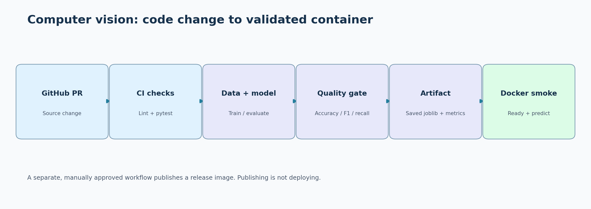

# Production-style computer vision MLOps: GitHub Actions + Docker + FastAPI

**Task:** classify 8×8 grayscale handwritten digit images (0–9) using `sklearn.datasets.load_digits` (no external dataset downloads). This is an **educational, end-to-end reference implementation**, not a claim of clinical/large-scale production readiness.

## Why this project?

Code that runs is not necessarily a good ML system. This repository enforces data contracts, dataset split integrity, candidate performance, per-class recall, inference contracts, API input validation, model artifact creation, and container smoke tests. A manual release workflow publishes a SHA-tagged GHCR image **only after repeating the quality checks**.

### Architecture



## Quick start (Python 3.12 recommended)

From the project root:

```bash
python -m venv .venv
# Windows PowerShell: .\.venv\Scripts\Activate.ps1
# macOS/Linux: source .venv/bin/activate
python -m pip install -r requirements-dev.txt
python -m pip install --no-deps -e .
ruff check src tests scripts
python -m pytest -v
python -m vision_mlops.pipeline --output-dir models
python scripts/plot_report.py
uvicorn vision_mlops.api:app --reload
```

Now open `http://127.0.0.1:8000/docs` or, in a second terminal, run `python scripts/smoke_test.py`. The API accepts **exactly 8×8 numbers in [0,16]**, not uploaded JPG/PNG images: this matches the dataset representation. To build a real photo OCR application you would need image decoding, resizing, and a suitably trained model.

## Docker

First run `python -m vision_mlops.pipeline --output-dir models` to create the **quality-gated** model file. Then:

```bash
docker build -t vision-mlops:local .
docker run --rm -p 127.0.0.1:8000:8000 vision-mlops:local
# or: docker compose up --build
```

The model is intentionally **not committed** into Git. A CI job creates and validates it, uploads it as a workflow artifact, and a downstream CI job downloads that artifact to build the image. The publish workflow rebuilds a validated model in the same run before packaging. Only load trusted joblib artifacts: they use Python pickle serialization.

## GitHub Actions

- `.github/workflows/ci.yml`: Every push or PR targeting `main`: lint → tests → held-out model checks → evaluation plots → upload artifacts → build Docker → readiness + prediction smoke test.
- `.github/workflows/publish.yml`: Manually triggered on `main`; uses environment `release` (configure optional required reviewers in GitHub Settings), repeats checks, publishes to `ghcr.io/<owner>/<repo>:<commit-sha>`. **Publishing is not automatic deployment.** The repository does not modify a remote production host.

Enable branch protection/rulesets on `main`, require successful CI checks, and configure `release` environment protection as appropriate. Review the GitHub Actions trust boundary before enabling workflows from external pull requests. Published images should be deployed using pinned tags or digests, with rollback to the previous digest.

## Validation gates

| Gate | Definition | Threshold / rule |
|---|---|---|
| Data integrity | Shapes, finite range, ten classes | 8×8, values 0..16, 0..9 labels |
| Split integrity | Unique indices, stratified deterministic split | 60% train / 20% val / 20% test |
| Accuracy | Held-out test classification | ≥ 0.94 |
| Macro F1 | Mean class F1 | ≥ 0.94 |
| Per-class recall | Avoid sacrificing a digit | Every class ≥ 0.80 |
| Naive-reference improvement | Candidate macro F1 minus dummy macro F1 | ≥ 0.20 |
| API | Strict 8×8 input, model readiness | HTTP 422 or 503 for invalid/unavailable |
| Container | image builds, readiness and inference | Smoke test passes |

**Honesty note:** The dummy baseline is a *naive reference*, not the previous production model. True model-regression gates require a trusted frozen incumbent evaluated on exactly the same held-out test set. Training is repeated on PRs because this dataset is tiny; for large models, do cheap PR checks and schedule/trigger separate GPU evaluation. A repeatedly used test set can become overfit via model-selection decisions; keep a separate, locked final acceptance dataset for production.

## Follow the lessons

1. `docs/01_understand.md`: architecture, data, model, execution.
2. `docs/02_quality_gates.md`: why tests go beyond pytest code checks.
3. `docs/03_github_actions.md`: CI jobs, artifacts, build and approval.
4. `docs/04_exercises.md`: deliberately break schemas/metrics/API and interpret failures.
5. `docs/05_production_gaps.md`: remaining concerns to address before real deployment.

## Reproducibility and limitations

Dependencies are pinned for the tutorial environment; OS, wheel indexes, and future vulnerabilities still need attention. The holdout and seed are fixed, model and dataset hashes are saved, Python/sklearn/numpy versions are recorded. Confidence from `predict_proba` is *not* a calibrated probability guarantee. This is a 1,797-example educational dataset, not a natural-image benchmark. Model API calls are synchronous and unbatched. Model files are generated at build time and should be treated as trusted build outputs.
