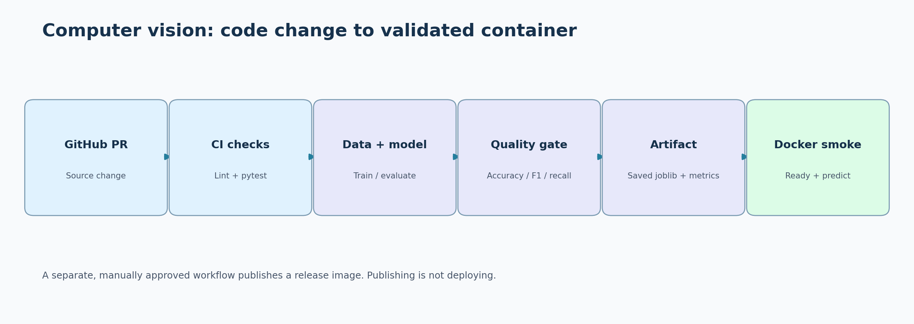

# Lesson 1: follow the entire ML system



1. `src/vision_mlops/data.py`: download-free digit images, data contract, fixed indices for 60/20/20 splits.
2. `src/vision_mlops/model.py`: standardized logistic regression candidate; dummy majority-class *reference*. Scaling is inside the training pipeline to prevent leakage.
3. `src/vision_mlops/pipeline.py`: train using train only; examine validation metrics; evaluate the holdout and enforce test gates; save `models/metrics.json` and trusted `model.joblib` on pass.
4. `scripts/plot_report.py`: confusion matrix and per-digit recall. Review them even if aggregate F1 is high.
5. `src/vision_mlops/api.py`: strict input, liveness/readiness, prediction. Inference is decoupled from training.

## Try locally

```bash
python -m pytest -v
python -m vision_mlops.pipeline --output-dir models
python scripts/plot_report.py
```

Open `models/metrics.json`, `reports/confusion_matrix.png`, and `reports/per_class_recall.png`. Ask: Is a single poor-performing digit hidden by high average accuracy?
