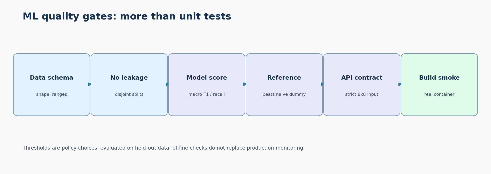

# Lesson 2: ML-specific validation gates

| Layer | Example | Why important |
|---|---|---|
| Code | Ruff + pytest | Catch syntax and logic errors |
| Data | Shape, ranges, labels | Catch unexpectedly changed input data |
| Split | No overlap, stratified fixed seed | Avoid training on test examples |
| Model | Accuracy, macro-F1, per-class recall | Healthy behavior on multiple quality dimensions |
| Reference | Better than majority-class dummy | Reject broken training that predicts only one digit |
| Contract | Probability vector, labels, API 422 | Prevent mismatch between trained model and serving code |
| Release | Real Docker readiness and prediction | Catch packaging/runtime errors |

Thresholds are explicitly chosen for the fixed educational benchmark, not universal ML targets. Validate on a representative dataset and add confidence intervals for high-stakes releases. A model can pass offline checks while failing after distribution shift: set up production monitoring and drift alerts separately.

`model.joblib` is written only if the model quality gates pass. Note that `metrics.json` is still written on failure so debugging artifacts remain available.
