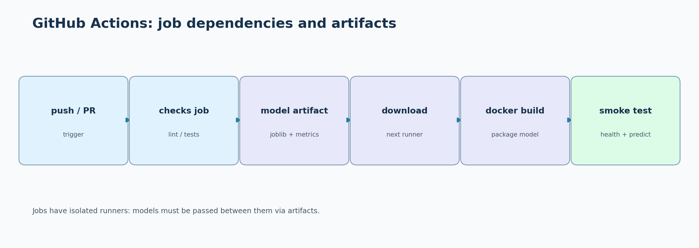

# Lesson 3: examine GitHub Actions line by line

## CI: `.github/workflows/ci.yml`

- **Event:** pushes/PRs to `main`, manual runs.
- **checks job:** install pinned packages, lint, test, train, generate report; upload model + reports as artifacts.
- **docker-smoke job:** `needs: checks`; downloads those exact artifacts, builds a Docker image and starts it; sends readiness and prediction requests.
- **Artifacts vs cache:** artifacts carry report/model files between jobs; pip cache speeds downloads. Never confuse a cache with a model registry.
- **Failing tests:** job fails; downstream `docker-smoke` is skipped. Report upload still runs with `if: always()`.

## Release: `.github/workflows/publish.yml`

- Manual (`workflow_dispatch`), restricted to `main`.
- Uses `release` environment: to enforce human review, configure required reviewers under repository Settings > Environments where available.
- Repeats validation, builds model and publishes an image into GitHub Container Registry (GHCR) using built-in `GITHUB_TOKEN`.
- Uses exact commit SHA tag. No `latest` tag and no automatic production deployment.

## Security cautions

Actions use release tags for readability here; high-security repositories should pin third-party/official actions to audited full commit SHAs, review dependabot updates, and consider provenance attestations. Limit token privileges and do not inject privileged secrets into untrusted PR jobs. For serious releases, evaluate base-image vulnerabilities, produce SBOM/provenance, and sign images.
